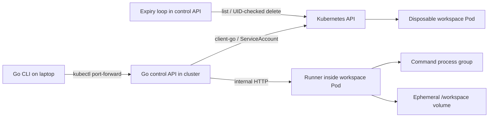

# Sandbox Cloud

**Disposable Kubernetes workspaces, controlled from a Go CLI.** Create a workspace,
put files into it, run commands with streamed output, inspect the result, and destroy
it—or let its lifetime expire.

[View the standalone project landing page](landing/index.html) · [Read the deployment runbook](deploy/README.md)

This project is an engineering exercise in Kubernetes lifecycle management,
process execution, failure handling, and measurement. Its initial workload is a
trusted coding task: edit a small Go project and run its tests in a disposable
remote environment.

Container images are intended to be built and stored in GCP. Local development
requires Go, not Docker, a local Kubernetes cluster, or downloaded container images.

## Implementation and verification status

| Area | Current status |
| --- | --- |
| Go CLI | Implemented: animated creation/watch views, plain text, and JSON |
| Control API | Implemented: create, inspect, list, delete, runner forwarding |
| Workspace lifecycle | Implemented with Kubernetes Pods and expiry reconciliation |
| Runner | Implemented: file uploads, serial command execution, streaming, cancellation, deadlines |
| Integration tests | CLI → HTTP API → runner tested with a simulated Kubernetes client |
| Build and race checks | Passed on macOS/arm64; server binaries also cross-compiled for Linux/amd64 |
| Terminal preview | Executed in a real PTY; simulated state is explicitly labeled |
| Cloud deployment | **Not deployed or verified against GKE yet** |
| Build/deployment configuration | Prepared in `Dockerfile`, `cloudbuild.yaml`, and `deploy/`; not applied |
| Isolation | Trusted workloads only; not a hostile-code sandbox or multi-tenant service |

The tests do not simulate Kubernetes admission, scheduling, networking, kubelet
behavior, IAM, or image pulling. A passing local test is not evidence that the
cloud deployment works.

## Quick start: build and preview locally

Prerequisite: Go 1.26 and a Unix-like development host. The production runner
supports Linux; process behavior can also be tested on macOS.

```sh
# Explicit dependency setup, requiring network access if modules are missing.
GOTOOLCHAIN=local go mod download

# These targets disable module downloads and automatic toolchain downloads.
make build
make check

# An animated, explicitly simulated UI; creates no workspace and makes no request.
./bin/sandbox preview

# Machine-readable preview, also offline.
./bin/sandbox --json preview
```

`make build` produces `bin/sandbox`, `bin/sandboxd`, and `bin/sandbox-runner`.
`make check` runs build, vet, normal tests, and race tests. Integration tests bind
loopback ports and execute controlled shell commands in temporary directories.
They need permission to bind local sockets if the development environment is
sandboxed.

Do not run `sandbox-runner` directly on your laptop with untrusted commands. It
executes as its operating-system user; the surrounding Pod provides the intended
resource and filesystem boundaries.

## Architecture



Three binaries have different responsibilities:

| Component | Responsibility | State owner |
| --- | --- | --- |
| `sandbox` | User interaction, file transfer, output display | No authoritative execution state |
| `sandboxd` | Workspace operations, runner routing, expiry reconciliation | Kubernetes owns the workspace records |
| `sandbox-runner` | Processes, files, output, command results | Runner memory and the workspace volume |

The control API uses `rest.InClusterConfig()`: its identity comes from its
ServiceAccount. It does not implicitly select a context from your laptop's
kubeconfig. The CLI talks to the application API, not directly to Kubernetes.

### Why Pods rather than Jobs or Deployments?

A workspace survives multiple command invocations. A Job describes a workload
that runs to completion; that is a different lifecycle. The workspace runner
stays alive between commands, so the control API creates a Pod directly.

A Deployment is appropriate for the control API because replacing it restores a
service whose workspace inventory is stored elsewhere. Automatically replacing a
workspace with an empty Pod would lose files and command history while appearing
to recover the same workspace. Workspace Pods therefore use `restartPolicy: Never`.

There is no application database, custom Kubernetes resource, scheduler, or
persistent command queue in this version. These would introduce additional state
and recovery semantics without being necessary for the first execution flow.

## Trace: create, upload, execute, expire

1. The CLI generates a workspace ID before sending `POST /v1/workspaces` and
   prints it to stderr. If the response is lost, the user can inspect that ID.
2. The API creates a Pod with ownership labels, an absolute expiration timestamp,
   a configured runner image, and resource restrictions. The accepted response
   means the Pod object exists; it does not mean the runner is ready.
3. The CLI polls the API once per second. The API derives status from the Pod:
   unscheduled, starting, ready, terminated, or unavailable. Kubernetes scheduling
   and container waiting reasons are shown when present.
4. Once ready, the API forwards a file upload to the runner's private Pod IP. The
   runner writes beneath `/workspace`, using a temporary file and rename.
5. The CLI generates a command ID and submits an executable, argument array, and
   timeout. The runner admits the command if the workspace is idle, starts its
   process group, and immediately returns the command ID.
6. The CLI opens a separate NDJSON event stream. Output is retained in bounded
   memory, streamed as it arrives, and followed by a final result.
7. A later command sees files left by the previous command. There is no automatic
   shell interpolation: shell syntax requires explicitly running `sh -c`.
8. At expiration, the API rejects further runner operations. Its reconciliation
   loop requests Pod deletion. Kubernetes removes the Pod and ephemeral volumes.

## Workspace state and expiration

| API state | Meaning |
| --- | --- |
| `pending` | Pod exists and has not been assigned a node |
| `starting` | Node assigned; runner is not yet ready |
| `ready` | Pod is Running and its Ready condition is true |
| `terminated` | Pod or runner has terminated |
| `unavailable` | Pod state is Unknown or expiration metadata is invalid |
| `expired` | The absolute expiration timestamp has passed |
| `terminating` | Kubernetes has accepted deletion and removal is in progress |

Labels identify workspace Pods. Annotations record `sandbox-cloud/expires-at`
and the requested TTL. List and reconciliation operations select only Pods with
both this application's owner label and the workspace component label.

The expiry loop runs immediately on API startup, then every five seconds. Each
pass is bounded by a 15-second request context. It reads Kubernetes state rather
than reconstructing timers from process memory. Invalid expiration metadata is
reported and left for investigation; it is not guessed.

Deletion includes the Pod UID as a precondition. If the original Pod has been
replaced under the same name, Kubernetes must reject the stale deletion.

A Pod `activeDeadlineSeconds` also provides a kubelet execution backstop. That
clock is tied to Pod start, whereas the application expiration is calculated at
creation. They are not identical when scheduling is delayed. Reconciliation,
network outages, kubelet availability, and termination grace can delay physical
cleanup beyond the annotated expiration. **This is eventual cleanup, not a hard
wall-clock destruction guarantee.**

## Command execution and concurrency

The runner allows **one active command per workspace**. Another command or a file
upload during execution receives HTTP 409. Different workspace Pods can execute
independently.

The runner uses one mutex for admission and access to command results/output.
Stdout and stderr are read concurrently by Go's process machinery, so their
writers also use that mutex. The lock establishes the invariant that two callers
cannot both observe an idle workspace and start commands.

Command lifetime is independent of the submitting HTTP request. A client
connection disappearing does not cancel execution. A runner-owned timeout kills
the process group, and an explicit cancellation request uses the same mechanism.
Remaining processes in that group are cleaned up when execution ends. A process
that deliberately detaches into another process group is outside the trusted
workload contract; Pod teardown remains the broader cleanup boundary.

Output subscribers take a snapshot and capture a change-notification channel
under the same mutex. Writers close that channel when output changes. Completion
also signals it. This prevents a lost wakeup between observing output and waiting
for more, without periodically polling the command state.

| Result state | Meaning |
| --- | --- |
| `running` | Command was accepted and its process started |
| `succeeded` | Process completed successfully and cleanup succeeded |
| `failed` | Nonzero exit or process/cleanup error |
| `timed_out` | Runner deadline expired |
| `cancelled` | Explicit cancellation or runner shutdown interrupted execution |

An executable that cannot be started returns HTTP 422 without consuming the
active-command slot. At the boundary between completion and cancellation, the
runner's observed context and process result determine the final classification;
there is no durable distributed ordering between those events.

### Retention, reconnects, and retries

- At most 32 accepted commands are retained per runner lifetime.
- Each command retains at most 1 MiB of combined output and at most 4096 chunks.
- Exceeding output limits sets `truncated`; output is drained so the process can
  continue, but excess bytes are not retained or replayed.
- An event stream replays retained output from the beginning and follows new
  output. There is no offset-based resume protocol; reconnecting can repeat text.
- While a command is retained, the same ID and identical request return the
  existing command. Reusing that ID with different settings returns HTTP 409.
- Eviction or runner loss forgets the command ID. This is bounded deduplication,
  **not durable exactly-once execution**.
- The CLI does not automatically retry command submission after a transport
  failure. Inspect the command ID first; its outcome may be unknown.

## CLI usage

After a reviewed deployment and port-forward are running, the default API URL is
`http://127.0.0.1:8080`. Override it with `SANDBOX_API` or the global `--api` flag.
HTTP endpoints must be loopback addresses; remote URLs require HTTPS. The initial
single-user deployment is intended to use port-forwarding, not a public endpoint.

```sh
sandbox create --ttl 20m
sandbox list
sandbox inspect sbx-0123456789abcdef01234567
sandbox watch
sandbox watch sbx-0123456789abcdef01234567

sandbox put sbx-0123456789abcdef01234567 ./examples/hello .
sandbox exec --timeout 60s sbx-0123456789abcdef01234567 -- go test ./...
sandbox exec sbx-0123456789abcdef01234567 -- sh -c 'echo hello; sleep 1'

sandbox result sbx-0123456789abcdef01234567 cmd-0123456789abcdef01234567
sandbox logs sbx-0123456789abcdef01234567 cmd-0123456789abcdef01234567
sandbox cancel sbx-0123456789abcdef01234567 cmd-0123456789abcdef01234567
sandbox destroy sbx-0123456789abcdef01234567

sandbox --json list
sandbox --json create --ttl 10m --wait 0
```

Use the IDs returned by your own commands; the examples above use placeholders.
Global flags precede the command; command flags precede positional arguments.

Creation waits up to three minutes by default; `--wait 0` returns immediately.
Stopping the wait does not delete the workspace. `watch` exits on `q`, Escape, or
Ctrl-C without changing workspace state. Ctrl-C during execution stops the local
stream; use `cancel` when you intend to stop the remote command.

The interactive views use Bubble Tea and Lip Gloss. Their spinners reflect
observed pending/starting states; they do not estimate image-download percentage.
Non-interactive output uses text tables, and `--json` disables animations. JSON
execution/log output is an NDJSON event stream; progress IDs and diagnostics go to
stderr. Ordinary remote exit codes 1–125 propagate to the CLI; cancellation,
signals, and other failures use a nonzero fallback. A local interrupt exits 130.

Uploads accept regular files or recursively walk a directory. Remote paths are
relative to `/workspace`; symlinks are rejected, file mode becomes 0644, and empty
directories are not preserved. A directory upload is a sequence of atomic file
uploads, not an atomic snapshot. Earlier files remain if a later upload fails.
No automatic ignore rules are applied: choose the source directory carefully.

## HTTP contract

| Method and path | Result |
| --- | --- |
| `GET /healthz` | Process HTTP health; not a Kubernetes connectivity check |
| `POST /v1/workspaces` | Create or retrieve a workspace with matching settings |
| `GET /v1/workspaces` | List managed workspaces |
| `GET /v1/workspaces/{id}` | Inspect derived Pod state |
| `DELETE /v1/workspaces/{id}` | Request deletion; not synchronous physical removal |
| `PUT /v1/workspaces/{id}/files?path=relative/path` | Upload one file |
| `POST /v1/workspaces/{id}/commands` | Start a command |
| `GET /v1/workspaces/{id}/commands/{command}` | Read a retained command result |
| `GET /v1/workspaces/{id}/commands/{command}/events` | Replay and follow NDJSON output |
| `POST /v1/workspaces/{id}/commands/{command}/cancel` | Request cancellation |

Example request bodies:

```json
{"id":"sbx-0123456789abcdef01234567","ttl_seconds":1200}
```

```json
{"id":"cmd-0123456789abcdef01234567","command":["go","test","./..."],"timeout_seconds":60}
```

Output event and final result:

```json
{"stream":"stdout","data":"ok example\n"}
{"stream":"result","result":{"id":"cmd-0123456789abcdef01234567","state":"succeeded","exit_code":0,"started_at":"2026-10-31T12:00:00Z","finished_at":"2026-10-31T12:00:01Z","truncated":false}}
```

Errors use `{"error":"message"}`. Validation returns 400; missing objects return
404; workspace/command conflicts return 409; oversized uploads return 413; process
start errors return 422. Kubernetes permission/quota failures are exposed as
errors rather than retried indefinitely. Once streaming headers have been sent,
a broken stream may end without a final result; the client reports an unknown
outcome instead of manufacturing success.

## Resource and security boundaries

Current generated workspace defaults:

| Setting | Value |
| --- | --- |
| TTL | Default 20 minutes; allowed 1 minute–24 hours |
| Command timeout | Default 60 seconds; allowed 1 second–1 hour |
| CPU request / limit | 100 millicores / 1 core |
| Memory request / limit | 128 MiB / 512 MiB |
| Ephemeral storage request / limit | 128 MiB / 1 GiB |
| Workspace volume size limit | 512 MiB |
| Temporary volume size limit | 256 MiB |
| Upload maximum | 8 MiB per file |
| Runtime UID/GID | 65532 |
| Pod termination grace | 5 seconds |

The Pod specification disables service-account token automount and service-link
environment injection, drops Linux capabilities, disallows privilege escalation,
uses RuntimeDefault seccomp, and mounts the image root filesystem read-only.
`/workspace` and `/tmp` remain writable. Storage limits depend on kubelet
accounting/enforcement; they are not per-write filesystem quotas.

These restrictions do not create a hostile-code security boundary. Commands run
under the same UID as the runner, normally share the worker kernel, and may
interfere with the runner. This version has no per-user authorization, public API
authentication, strong egress isolation, or durable audit log.

Before deployment, workspace runner ingress must be restricted to the control
API with enforced NetworkPolicies. The API must remain internal. The intended
control-plane ServiceAccount needs only namespaced Pod `create`, `get`, `list`,
and `delete`; workloads receive no Kubernetes credentials. Permission to create
Pods is itself powerful, so the workspace namespace should not contain unrelated
credentials or workloads. Do not treat application labels as an authorization
boundary against principals who can edit Pods in that namespace.

The application currently has no global admission limit. A reviewed namespace
ResourceQuota is required to bound aggregate workload count/resources before a
shared deployment. No warm pool or application job queue is implemented.

## Failure behavior

| Failure | Behavior and limit |
| --- | --- |
| CLI disconnect | Command continues; reconnect with its ID while retained |
| API restart | Existing Pods and runner commands remain; inventory and expiry are read from Kubernetes |
| Runner crash | In-memory output/results are lost; Pod is not automatically restarted |
| Node loss | Workspace may be unavailable or lost; no durable file recovery |
| Command timeout | Runner terminates process group; independent of client connection |
| Image pull failure | Pod waiting reason is exposed; no fake ready state or blind retry |
| Kubernetes unavailable | Operations fail; expiry resumes after access returns |
| Concurrent command submissions | One admitted, the other receives 409 |
| Lost create response | Inspect printed workspace ID; matching retained Pod supports idempotent create |
| Lost command response | Inspect printed command ID; do not blindly resubmit |
| Oversized/interrupted upload | Existing target file survives; temporary file is cleaned up |
| Stale cleanup request | UID precondition prevents deleting a different Pod under the same name |

## Performance: measured locally, not on GKE

A baseline exposed a 50 ms polling interval in output delivery. Replacing polling
with state-change notifications reduced the local HTTP command round-trip time
for the **same workload and completion/output contract**.

Environment: Apple M4 Pro, macOS/arm64, Go 1.26.0; the benchmark's Go runtime reported
12 logical CPUs. Each iteration submits `true` over loopback HTTP, starts the
process, attaches to the event stream, and consumes its final result. It excludes
server startup, Kubernetes, container startup, image pulls, and cloud networking.
Three samples of 20 iterations were collected for each implementation, without
the race detector.

| Sample | Before: 50 ms poll | After: notifications |
| --- | ---: | ---: |
| 1 | 54.572 ms/op | 2.065 ms/op |
| 2 | 53.453 ms/op | 1.672 ms/op |
| 3 | 55.959 ms/op | 1.619 ms/op |

After-change allocation measurements were approximately 122–123 KiB/op and
318–320 allocations/op. This is a small diagnostic sample, not a statistical
latency distribution or a cloud capacity claim. `benchstat` was not installed;
no significance test was run. The original polling implementation is described
here for comparison; the current benchmark exercises the notification version.

Reproduce the current workload:

```sh
GOTOOLCHAIN=local GOPROXY=off GOSUMDB=off \
  go test ./internal/runner -run '^$' \
  -bench BenchmarkCommandRoundTrip -benchmem -benchtime=20x -count=3
```

The next measurements require a real deployment: request-to-Pod-ready latency,
cold versus cached images, command-start latency through the control API, and
behavior at increasing workspace concurrency. Record cluster/node size, image
digest and size, scheduling conditions, and failures alongside p50/p95/p99. CLI
readiness polling has one-second granularity and should not be used as the
precision benchmark instrument. There are no GKE performance numbers yet.

## GCP deployment plan — not yet applied

The GKE cluster is running and its metadata has been verified:

- Project: `my-dev-server-507301`
- Cluster: `sandbox-cluster1`
- Location: `us-central1`
- Mode/version: Autopilot, `1.36.4-gke.2046003`
- Control-plane access: DNS enabled, external DNS access allowed, IP endpoints disabled
- Datapath: `ADVANCED_DATAPATH` (Dataplane V2)
- GKE, Cloud Build, and Artifact Registry APIs: already enabled

This confirms cluster provisioning, not application deployment. The local
`gke-gcloud-auth-plugin` is installed and namespace listing succeeded through the
DNS endpoint. The connection uses `~/.kube/sandbox-cloud.config`, separate from
existing contexts. Remote build/deployment files are prepared; see
[`deploy/README.md`](deploy/README.md) for the exact review and execution steps. An existing cluster
must have enforced NetworkPolicies. Linux nodes are required. Cluster cost and
capacity remain decisions for the owner; this repository does not provision a
cluster or alter billing.

The intended deployment has:

1. A remote Cloud Build process that compiles Go binaries and builds two images:
   a minimal control API image and a workspace image containing the Go toolchain,
   Git, a shell, and the runner. The laptop does not build or pull images.
2. An Artifact Registry repository holding immutable image versions. Workspace
   creation uses the server-configured image, not a caller-supplied arbitrary image.
3. Separate control and workspace namespaces, a dedicated control ServiceAccount,
   namespaced RBAC, an internal API Service, and a single API Deployment.
4. Workspace NetworkPolicies restricting runner ingress to the control API, plus
   a ResourceQuota bounding aggregate resource use. Egress policy must be decided
   explicitly around dependencies and the trusted workload scope.
5. An explicit-context `kubectl port-forward` to reach the internal API from the
   laptop. No public load balancer is required for the first demo.

The application entry points are:

```text
sandboxd --listen=:8080 --namespace=sandbox-workspaces --workspace-image=REGISTRY/IMAGE@sha256:DIGEST
sandbox-runner --listen=:8090 --workdir=/workspace
```

Both paths above describe in-cluster execution. The runner's default listen
address is loopback; a Pod launch must explicitly select its internal interface.
The control API requires in-cluster ServiceAccount configuration.

Cloud Build submission, registry creation, IAM, namespace manifests,
NetworkPolicies, and quota settings must be reviewed before applying changes.
Deployment/build configuration is prepared but has not been executed. The current client-go version
is 0.35.1; check its compatibility with the selected cluster before deployment.

### Live acceptance checks after deployment

- Create one workspace and observe scheduling, image pull, and readiness.
- Upload `examples/hello` and run `go test ./...` with streamed output.
- Verify a failed command propagates its exit code.
- Execute a long command, disconnect, reconnect, and cancel it.
- Restart the control API while a workspace is active and recover its status.
- Let a short-lived workspace expire; verify its Pod and files are removed.
- Verify a workspace cannot call another runner or reach Kubernetes credentials.
- Exercise configured aggregate quotas and inspect the failure/pending behavior.

These checks are **not yet run**. Local fake-client tests cannot establish them.

## Troubleshooting

| Symptom | First check |
| --- | --- |
| Connection refused on port 8080 | Is the explicit-context port-forward running? |
| Workspace stays pending | Inspect `Reason`; check node capacity and Pod scheduling events |
| ImagePullBackOff | Check the image reference and the node identity's registry access |
| Runner unavailable | Check Pod readiness, ingress policy, and control-to-workspace routing |
| Workspace busy | Inspect/cancel the existing command before uploading or starting another |
| Command not found | Confirm workspace and command IDs; result may be evicted or runner lost |
| GCP 403/project not found | Confirm the project ID and the account used by local gcloud |
| Pod remains after TTL | Check API reconciliation errors, API permissions, and cluster availability |
| Go build tries to download dependencies | Run explicit dependency setup first; make targets intentionally use GOPROXY=off |

Do not interpret an optional gcloud component-update notice as a fix for IAM
permission failures. Authentication, project access, and cluster access are
separate checks.

## Development reading path

1. [`internal/cli/cli.go`](internal/cli/cli.go): follow `create`, `put`, and `exec`;
   [`ui.go`](internal/cli/ui.go) contains the terminal update loop.
2. [`internal/client/client.go`](internal/client/client.go): HTTP boundaries,
   deadlines, JSON decoding, and final-result handling.
3. [`internal/cloud/http.go`](internal/cloud/http.go), then
   [`kubernetes.go`](internal/cloud/kubernetes.go): routing, Pod ownership,
   state derivation, and expiry reconciliation.
4. [`internal/runner/runner.go`](internal/runner/runner.go), then
   [`process_unix.go`](internal/runner/process_unix.go): command admission,
   notifications, process groups, and file writes.
5. [`internal/cli/integration_test.go`](internal/cli/integration_test.go): trace a
   complete CLI → API → runner flow; the cloud and runner package tests exercise
   ownership, expiry, failure, and concurrency boundaries.

Entry points under `cmd/` wire configuration, signals, and HTTP server shutdown.
There are no commits, publishing steps, or cloud mutations implicit in `make`.

## References

- [Kubernetes Pod lifecycle](https://kubernetes.io/docs/concepts/workloads/pods/pod-lifecycle/)
- [Kubernetes RBAC good practices](https://kubernetes.io/docs/concepts/security/rbac-good-practices/)
- [client-go](https://github.com/kubernetes/client-go)
- [Bubble Tea v1.3.10](https://github.com/charmbracelet/bubbletea/tree/v1.3.10)
- [Lip Gloss](https://github.com/charmbracelet/lipgloss)

The guarantees above describe this implementation, not every behavior available
in Kubernetes or future versions of this project.
